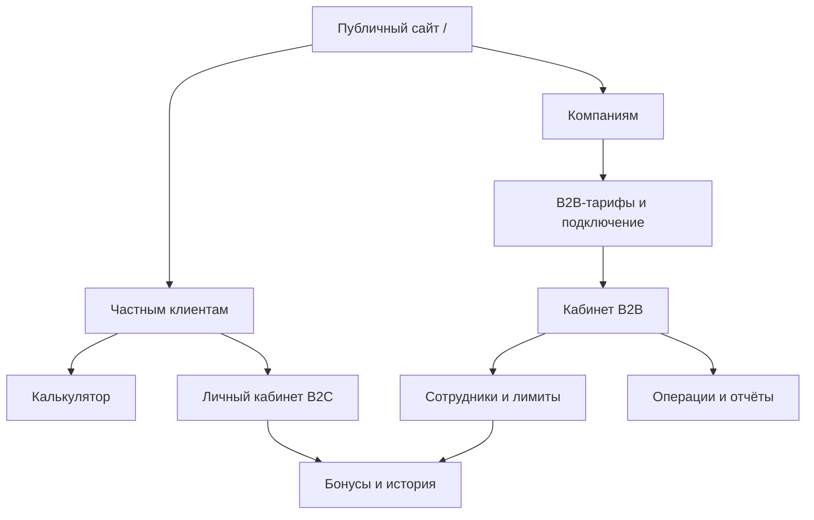
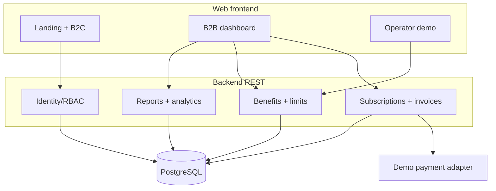

# Архитектура «Почта Премиум» — PostCode Challenge 2.0

> Версия 1.0 · 26 ноября 2026 · Проектная спецификация MVP, а не описание действующих сервисов Почты России.\
> Трек 3: «Почта Премиум». Дедлайн: **1 декабря 2026, 23:59 МСК**.\
> Источники: [шесть задач Codenrock](https://codenrock.com/contests/khakaton-postcode-challenge-ot-pochtatekha2/tracks/f9714d65-adf7-4dd1-b203-471befda2e2f/tasks), приложенные ТЗ, B2B-спецификация и распределение ролей команды.

## 1. Продукт в одном предложении

**Почта Премиум** — единая платформа подписки на почтовые услуги, которая **до оплаты показывает персональную выгоду**, **после оплаты прозрачно учитывает каждый бонус**, а **компаниям даёт контроль сотрудников, лимитов, счетов и экономии**.

### Целевая аудитория

1. **B2C:** частые отправители, покупатели/продавцы на площадках, семьи с регулярными отправлениями.
2. **B2B:** небольшие интернет-магазины, продавцы маркетплейсов, сервисные компании и распределённые команды с регулярными отправлениями.
3. **Операторы:** демонстрационная роль сотрудника отделения, помогающая показать применение бонуса к операции (дополнительный модуль команды).

Не обещать неподтверждённые преимущества вроде гарантированного приоритета очереди, договоров с партнёрами или реальных скидок: всё подобное — **гипотеза для пилота**.

## 2. Чем отличаться от обычного лендинга подписки

| Функция / конкурентное отличие | Почему это интересно | Как показать на защите | Приоритет |
|---|---|---|---|
| **Честный калькулятор с отрицательным результатом** | Не скрывает, кому подписка невыгодна; повышает доверие | Малый объём → «не окупается», большой → экономия с учётом лимита | P0 |
| **Прозрачный «чек выгоды»** | Можно проверить, откуда взялась каждая сэкономленная сумма | Операция → исходная цена → скидка → расход лимита → итог | P0 |
| **Командный кошелёк преимуществ, не денег** | Администратор распределяет пользу между сотрудниками, не создавая банковский кошелёк | Назначить лимит → использовать бонус → остаток снижается | P0 |
| **Демо-подключение за один сценарий** | Жюри видит законченную бизнес-операцию | Тариф → тестовый счёт → демо-оплата → активная подписка | P0 |
| **Экономический «двойной экран»** | Показывает выгоду клиента и жизнеспособность экономики Почты отдельно | Слева экономия клиента, справа маржа, затраты и чувствительность | P0 (в отчёте/презентации) |
| **Симулятор «что если»** | Помогает клиенту выбирать тариф и компании — распределять ресурсы | Изменить количество отправлений, долю активаций, churn | P1 |
| **Объяснимые лимиты и причины отказа** | Убирает «магическое» поведение бонусов | «Лимит исчерпан», «нет прав», «подписка на паузе» | P0 |
| **Песочница для жюри с готовыми сценариями** | Воспроизводимость без регистрации и внешних сервисов | Переключить демо-персону, сбросить данные, повторить сценарий | P0 |
| **Уведомление о скором исчерпании лимитов** | Практическая польза для бизнеса | Индикатор 80% и предложение перераспределить лимит | P1 |
| **Приоритетная запись на сдачу партии** | Сотрудник резервирует интервал сдачи заранее; отличается от существующей сдачи онлайн-оплаченного отправления без очереди | Выбрать тестовый слот → забронировать → увидеть запись и остаток лимита | P1 |
| **Пакет плановых курьерских заборов** | Компания не тратит время на поездки в отделение; существующая услуга объединена с подпиской | Запросить демо-забор → подтвердить → увидеть расход пакета | P1 |
| **Шаблоны повторных отправлений** | Снижение времени работы, не только денежная скидка | Повторить сохранённую операцию | P2 |
| **Прогноз выгоды на конец месяца** | Понятное принятие решений | Сравнить текущий темп расходов с остатком лимита | P2 |

**Уникальность, которую стоит защищать:** не «ещё одна программа скидок», а **подписка с проверяемой окупаемостью и управляемым корпоративным потреблением**. Для B2B особенно важны совместное использование бонусов, детальные причины списания и отчёт о чистой выгоде.

## 3. Карта сайта и навигация



| Маршрут | Содержание | Роль | Владелец |
|---|---|---|---|
| `/` | Ценность, тариф, ограничения, бонусы, FAQ, CTA, форма предзаписи | Гость | №3 |
| `/calculator` | Расчёт скидок, лимитов, чистой выгоды, окупаемости | Гость | №3 |
| `/prelaunch` | Предзапись, отдельное согласие, подтверждение | Гость | №3 |
| `/subscribe` | Подключение и демо-оплата B2C | B2C | №3 |
| `/account` | Статус, история, бонусы, пауза, отмена | B2C | №3 |
| `/business` | Корпоративная ценность, 2 тарифа, сравнение, FAQ | Гость/админ | **№4** |
| `/business/connect` | Компания, выбор тарифа, тестовый счёт | Админ | **№4** |
| `/business/dashboard` | KPI, подписка, лимиты, активность, выгода | Админ | **№4** |
| `/business/employees` | Список, роли, добавление/отключение | Админ | **№4** |
| `/business/benefits` | Каталог, назначение прав и лимитов | Админ/сотрудник | **№4** |
| `/business/invoices` | Счета, статусы, имитация оплаты | Админ | **№4** |
| `/business/operations` | Журнал активаций, детали «чека выгоды» | Админ/сотрудник | **№4** |
| `/business/reports` | Расход, экономия, категории, сотрудники | Админ | **№4** |
| `/business/economics` | Внутренняя демо-модель экономики и сценарии | Демо/команда | **№4** |
| `/operator` | Демо-применение бонуса к почтовой операции | Оператор | №2, согласовать |
| `/logistics` | Демо-маршрутизация отправлений | Внутренняя роль | №1, опционально |

**Границы:** интерфейсы оператора/логистики присутствуют в распределении на скриншоте, но не относятся к обязательному ядру именно трека «Почта Премиум». Не отдавать им ресурсы в ущерб B2C/B2B-сценариям.

## 4. UX-сценарии и состояния

### 4.1. B2C: сквозной путь

1. Посетитель видит цену, набор услуг, лимиты и условия.
2. Указывает предполагаемую частоту и виды отправлений; калькулятор показывает **валовую выгоду, ограничение лимитом, стоимость подписки, чистую выгоду и точку окупаемости**.
3. При желании оставляет предзапись с явным согласием или запускает демо-подключение.
4. Имитация оплаты переводит подписку в `active`; доступен каталог бонусов.
5. Использование бонуса уменьшает остаток и добавляется в историю.
6. Пауза и отмена обновляют статус; экраны объясняют последствия.

**Состояния:** `draft`, `pending_payment`, `active`, `paused`, `cancelled`, `expired`. Не путать «отменено автопродление» с мгновенным прекращением уже оплаченного периода: правило явно описать в UI и тестах.

### 4.2. B2B: сквозной путь участника №4

1. Администратор выбирает между `Business Start` и `Business Plus`, видит лимиты и цену.
2. Создаёт демонстрационную компанию и заявку на подписку.
3. Система создаёт **тестовый счёт**; действие «Оплатить (демо)» активирует подписку.
4. Админ добавляет 2–3 сотрудников, назначает им доступ к бонусам и персональные лимиты.
5. Сотрудник выполняет тестовую операцию. Сервер проверяет компанию, роль, статус подписки, срок, лимит компании, лимит сотрудника и повтор операции.
6. Успешная операция фиксируется атомарно; остатки меняются.
7. Администратор видит детализацию, валовую выгоду, абонентскую плату, **чистую экономию** и остаток лимита.
8. В экономическом разделе демонстрируются три сценария для самой Почты.

**Дополнительный сценарий Business Plus (P1):** администратор назначает сотруднику права `priority_dropoff` и `courier_pickup`. Сотрудник бронирует тестовый интервал сдачи партии и создаёт демонстрационную заявку на забор отправлений. Система учитывает каждую подтверждённую активацию один раз, показывает остатки лимитов и позволяет отменить запись по правилам тарифа. Это имитация без реального бронирования отделения или вызова курьера.

**Ошибки для демо:** нет подписки, подписка на паузе, истёк срок, бонус не назначен, превышен лимит сотрудника, превышен лимит организации, повтор операции, недоступная акция.

## 5. UI-архитектура и дизайн-система

- **Визуальная идея:** доверие государственного почтового сервиса + премиальное, но спокойное оформление: синий, белый, тёплый кремовый и умеренные золотистые акценты.
- Шрифт: Golos (проверить лицензию и подключить локально); иконки — свободной лицензии.
- **Шапка:** «Частным» / «Бизнесу», тарифы, FAQ, кнопка входа.
- **B2B-sidebar:** Обзор, Сотрудники, Бонусы и лимиты, Операции, Счета, Отчёты.
- **Dashboard:** четыре KPI-карточки (тариф/срок, сотрудники, лимит, чистая выгода), прогресс-бар лимита, события, CTA «Добавить сотрудника».
- **Отчёт:** фильтры периода и сотрудника, таблица операций, отдельно абонентская плата и применённые выгоды.
- **Адаптивность:** десктоп 2–4 колонки; планшет 2; телефон 1; таблицы превращаются в карточки, главное действие фиксируется в зоне доступа.
- **Доступность:** читаемый контраст, подписи к полям, клавиатурная навигация, не кодировать статусы только цветом, понятные пустые состояния.

## 6. Рекомендуемый технический стек

> Рекомендация, если команда ещё не закрепила стек; существующий общий стек менять не нужно.

| Уровень | Предложение | Зачем |
|---|---|---|
| Frontend | React + TypeScript + Vite | Быстрое компонентное UI и типизация контрактов |
| UI | Tailwind CSS + доступные компоненты | Единый дизайн и адаптивность |
| Backend | FastAPI + Pydantic | Документируемый REST API, простая бизнес-логика |
| DB | PostgreSQL | Транзакции, связи и ограничения для лимитов |
| ORM/миграции | SQLAlchemy + Alembic | Контролируемая эволюция схемы |
| Авторизация | Демо-аккаунты + серверная проверка ролей | Без сложной внешней авторизации |
| Инфраструктура | Docker Compose | Локальный старт одной командой |
| Тестирование | Pytest + API-интеграционные тесты; Playwright при времени | Воспроизводимая приёмка |
| Экспорт | CSV | Дополнительный отчёт без внешних API |



**Принцип:** модульный монолит, а не микросервисы. Единый репозиторий, один backend, отдельные пакеты по доменам. Для хакатона это снижает риск интеграции.

### Предлагаемая структура репозитория

```text
pochta-premium/
  frontend/
    src/
      app/                 # маршруты, auth guard
      pages/public/
      pages/personal/
      pages/business/      # зона №4
      pages/operator/      # зона №2 при согласовании
      components/ui/
      features/subscriptions/
      features/benefits/
      features/business/   # зона №4
      services/api.ts
      types/api.ts
  backend/
    app/
      api/
      auth/
      subscriptions/
      billing/
      benefits/
      business/            # зона №4
      analytics/
      db/
      seed/
    tests/
  docs/
    ARCHITECTURE.md
    API.md
    ECONOMICS.md
    DEMO.md
  docker-compose.yml
  .env.example
  README.md
```

## 7. Модель данных

| Таблица | Ключевые поля | Инварианты |
|---|---|---|
| `users` | `id`, `name`, `email_demo?`, `role`, `status` | Синтетические пользователи; роли `personal`, `company_admin`, `company_employee`, `operator` |
| `companies` | `id`, `name`, `status`, `created_at` | Компания отделена от B2C |
| `company_memberships` | `company_id`, `user_id`, `role`, `status` | Роль задаётся в рамках компании; уникальная активная связь |
| `tariffs` | `id`, `audience`, `price_monthly`, `active`, `version` | Цены и версии тарифов фиксируются для операции |
| `tariff_benefits` | `tariff_id`, `benefit_id`, `rule_json`, `cap` | Преимущества задаются конфигурацией |
| `subscriptions` | `id`, `owner_type`, `owner_id`, `tariff_id`, `status`, `period_start`, `period_end` | Одна актуальная подписка на владельца в MVP |
| `invoices` | `id`, `subscription_id`, `amount`, `status`, `issued_at`, `paid_at` | Оплата только демонстрационная |
| `benefits` | `id`, `code`, `name`, `eligibility`, `unit_cost_assumption` | Условия и себестоимость явно определены |
| `benefit_limits` | `id`, `company_id`, `user_id?`, `benefit_id`, `period_start`, `period_end`, `limit_amount`, `used_amount` | Лимиты только для бонусов/выгоды, не банковский баланс |
| `benefit_usages` | `id`, `request_key`, `subscription_id`, `user_id`, `benefit_id`, `original_price`, `discount`, `status`, `created_at` | `request_key` уникален для защиты от двойного списания |
| `service_reservations` (P1) | `id`, `request_key`, `company_id`, `user_id`, `benefit_code`, `batch_id`, `location_demo`, `slot_start`, `slot_end`, `status`, `created_at` | Только синтетические адреса и отделения; уникальность запроса и партии; статусы, отмены и расход лимита согласованы |
| `events` | `id`, `event_name`, `anonymous_demo_session`, `timestamp`, `metadata` | Без реальных контактных данных |
| `prelaunch_signups` | `id`, `demo_contact?`, `consent`, `created_at` | Для защиты использовать синтетические записи |

В реальном продукте политику персональных данных, согласий и право на отказ надо проектировать отдельно; в MVP не хранить настоящие контакты, платёжные данные, токены и секреты в репозитории.

### Правило списания бонуса

1. Проверить роль и принадлежность компании (серверная RBAC).
2. Проверить активность и период подписки.
3. Проверить назначение бонуса, условия и период действия.
4. Проверить `request_key`: повтор возвращает прежний результат и **не списывает второй раз**.
5. В **одной транзакции** заблокировать соответствующие строки лимита организации и сотрудника, проверить остаток, записать использование, обновить оба счётчика, зафиксировать результат.
6. При отказе — структурированная причина и отсутствие списания.

Рассчитывать и округлять деньги в целых копейках (`integer`/`numeric`), не в `float`; хранить денежную единицу и версию правила расчёта.

## 8. Контракт API (MVP)

Общие ответы: JSON, ISO 8601 UTC, ошибки `{code, message, details}`. Сервер определяет пользователя и компанию из демо-сессии, не доверяя произвольному `company_id` клиента.

| Метод | Endpoint | Функция | Приоритет |
|---|---|---|---|
| GET | `/api/v1/tariffs?audience=b2b` | Корпоративные тарифы | P0 |
| POST | `/api/v1/companies` | Создать демо-компанию | P0 |
| GET | `/api/v1/companies/me/dashboard` | KPI кабинета | P0 |
| POST | `/api/v1/companies/me/subscriptions` | Выбрать тариф и оформить подписку | P0 |
| POST | `/api/v1/invoices` | Создать тестовый счёт | P0 |
| POST | `/api/v1/invoices/{id}/pay-demo` | Имитировать оплату | P0 |
| GET/POST | `/api/v1/companies/me/employees` | Список/добавление | P0 |
| PATCH | `/api/v1/companies/me/employees/{id}` | Отключение и роль | P0 |
| GET/PATCH | `/api/v1/companies/me/limits` | Чтение/настройка лимитов | P0 |
| GET | `/api/v1/benefits` | Каталог и доступность | P0 |
| POST | `/api/v1/benefit-usages` | Атомарная активация | P0 |
| GET | `/api/v1/companies/me/operations` | Журнал | P0 |
| GET | `/api/v1/companies/me/reports` | Выгода, затраты, разрезы | P0 |
| GET | `/api/v1/economics/scenarios` | Демонстрационная экономика | P0 |
| POST | `/api/v1/calculator/estimate` | B2C-выгода | P0 |
| POST | `/api/v1/prelaunch` | Демо-предзапись + согласие | P0 |
| POST | `/api/v1/events` | События воронки | P0 |
| GET | `/api/v1/companies/me/reports.csv` | Экспорт CSV | P1 |
| GET | `/api/v1/business/service-slots?type=priority_dropoff` | Тестовые свободные интервалы приёма партий | P1 |
| POST | `/api/v1/business/service-reservations` | Демо-бронь приёма партии или заявка на забор | P1 |
| POST | `/api/v1/business/service-reservations/{id}/cancel` | Отмена по правилам тарифа и возврат лимита при допустимом сроке | P1 |

**Контракт команды:** совместно утвердить `Tariff`, `Subscription`, `Benefit`, `BenefitUsage`, `Money`, статусную модель и коды ошибок до разделения веток. Для интерфейса участника №2 достаточно демо-вызова `benefit-usages`; логистика №1 не должна блокировать B2B.

## 9. Экономическая модель: отдельно клиент и Почта

### 9.1. Пример тарифов — только гипотезы

| | Business Start | Business Plus |
|---|---:|---:|
| Цена / мес. | 990 ₽ | 2 490 ₽ |
| Сотрудники | до 10 | до 30 |
| Максимальная выгода в месяц | 1 500 ₽ | 4 000 ₽ |
| Пример бонуса на отправление | 40 ₽ | 70 ₽ |
| Пример бонуса на упаковку | — | 40 ₽ |
| Отчётность | базовая | расширенная |
| Приоритетная запись на сдачу партии | — | 2 демо-брони / мес. |
| Плановый курьерский забор | — | 2 демо-забора / мес. |

**Статус двух новых льгот:** предложение для пилота, а не подтверждённые услуги в составе подписки Почты России. Почта уже предусматривает сдачу предварительно оформленных и оплаченных онлайн отправлений без очереди и отдельные курьерские услуги для бизнеса. Новая гипотеза — **бронирование конкретного слота для партии** и **фиксированное число плановых заборов внутри корпоративного тарифа**. Указанные два использования в месяц — стартовое модельное допущение.

### 9.1.1. Правила двух преимуществ Business Plus (P1)

| Правило | Приоритетная запись `priority_dropoff` | Курьерский забор `courier_pickup` |
|---|---|---|
| Кто может | Сотрудник с назначенным правом, активная подписка Plus | Сотрудник с назначенным правом, активная подписка Plus |
| Что вводит | Демо-отделение, партия, дата и временной слот | Тестовый адрес, партия, число отправлений, дата и окно |
| Проверки | Свободный будущий слот, уникальность партии, 2 брони на компанию в месяц | Поддерживаемая демо-зона и окно, уникальность партии, 2 забора на компанию в месяц |
| Статусы | `booked`, `cancelled`, `completed`, `no_show` | `requested`, `confirmed`, `cancelled`, `completed`, `unavailable` |
| Списание | Один раз при подтверждении бронирования | Один раз при подтверждении заявки |
| Отмена | До 2 часов до слота возвращает 1 использование; позже не возвращает | До 2 часов до окна возвращает 1 использование; позже не возвращает |
| Отчёт | Использования, отмены, остаток и отдельно оценка сэкономленного времени | Использования, отмены, остаток и модельная себестоимость курьера |

Правило отмены «за 2 часа» — **только пилотная гипотеза**. Операции должны быть идемпотентными и проверяться сервером на права, активность подписки, период, доступность и остаток лимита. Лимиты «2 брони» и «2 забора» учитываются **в единицах**, отдельно от денежного лимита скидок 4 000 ₽. Нельзя считать условно сэкономленное время денежной выгодой без обоснованной методики.

**Экономика:** себестоимость курьерских выездов, стоимость дополнительной обработки слотов и долю фактического использования добавить в сценарии Почты. Подписка за 2 490 ₽ не должна объявляться прибыльной без расчёта затрат на новые льготы; при отрицательной марже скорректировать цену, число включённых операций или условия доступности. При реальном внедрении нужны интеграции с расписанием отделений и курьерской системой, проверка региональных ограничений и операционных мощностей.

Для клиента: `выгода_до_лимита = Σ(количество_услуг × скидка_на_услугу)`; `применённая_выгода = min(выгода_до_лимита, месячный_лимит, применимые_персональные_лимиты)`; `чистая_экономия = применённая_выгода − плата_за_подписку`.

**Контрольный пример:** Plus, 40 отправлений × 70 ₽ + 10 упаковок × 40 ₽ = 3 200 ₽ применённой выгоды при лимите 4 000 ₽; после платы 2 490 ₽ **чистая выгода 710 ₽**. При 10 отправлениях и без упаковки чистая выгода отрицательна: 700 − 2 490 = **−1 790 ₽**. Это должно быть честно показано.

### 9.2. Экономика оператора сервиса

- `MRR = Σ ежемесячная плата по активным оплачиваемым подпискам` (не включать выручку от отправлений).
- `дополнительные операции = операции с подпиской − оценка операций без подписки`.
- `месячный вклад = подписочная выручка + маржа дополнительных операций − полные переменные затраты погашенных бонусов − переменное обслуживание`.
- `CAC = расходы на привлечение / новых платящих клиентов`.
- `churn = ушедшие в периоде / активные платящие на начало периода` (задокументировать учёт паузы).
- `LTV ≈ средний месячный вклад на компанию / месячный churn` при постоянных параметрах и положительном вкладе.
- `LTV/CAC = LTV / CAC`.
- `точка безубыточности (число компаний) = ceil(постоянные затраты / средний положительный вклад компании)`.

**Обязательная тонкость:** скидка на отправление, которое клиент и так бы совершил без подписки, тоже создаёт расход. Нельзя считать всю активность подписчиков «новой» выручкой. Стоимость предоставленного бонуса для Почты и размер выгоды клиента — **разные числа**.

### 9.3. Три сценария для документа и демо

| Параметр | Пессимистичный | Базовый | Оптимистичный |
|---|---|---|---|
| Количество компаний | низкое | среднее | высокое |
| Частота использования | высокая стоимость бонусов без роста отправлений | умеренный прирост | высокий прирост операций |
| CAC | высокий | умеренный | низкий |
| Churn | высокий | умеренный | низкий |
| Итог | выявить отрицательную маржу | показать устойчивость/условия | оценить потенциал |

В финальном бизнес-файле заменить качественные обозначения **числами с отдельной таблицей допущений**, указать источники и проверить чувствительность к churn, доле использования бонусов, марже и каннибализации.

## 10. Предзапись и аналитика эксперимента

**События:** `landing_view`, `calculator_used`, `subscribe_clicked`, `prelaunch_submitted`, `demo_payment_completed`, `benefit_activated`, `subscription_paused`, `subscription_cancelled`, `company_created`, `employee_added`, `limit_reached`, `report_viewed`.

Для каждой конверсии указать числитель, знаменатель, период и целевой порог. Например `prelaunch_submitted / unique_landing_visitors` за 7 дней. Предзапись **не доказывает готовность платить**: в пилоте дополнительно проверять реальную оплату, первую активацию, повторное использование и вклад относительно контрольной группы.

Предполагаемый эксперимент: два предложения цены/бонусов, одинаковые каналы привлечения, сопоставимые сегменты, предварительно заданные пороги продолжения/изменения/остановки. Реальные согласия и обработка персональных данных вне демо требуют отдельной правовой проверки.

## 11. Тестовые персоны и воспроизводимый сценарий

| Персона | Сценарий |
|---|---|
| `demo_personal` | Выгода → оплата → бонус → пауза/отмена |
| `demo_admin` | Создать «ООО Демо Маркет» → выбрать Plus → счёт → оплата → сотрудники → лимиты → отчёт |
| `demo_employee_1` | Получить доступ → применить бонус → увидеть только свои операции |
| `demo_employee_2` | Достичь персонального лимита → получить объяснимый отказ |
| `demo_operator` | Применить/подтвердить тестовую операцию при согласованной интеграции |

Добавить `seed` и `reset-demo`, чтобы проверяющие могли выполнить сценарий повторно. Приёмочные тесты: успешная оплата меняет статус; пауза запрещает списание; роль сотрудника не открывает отчёты компании; повтор запроса не списывает дважды; конкурентные запросы не превышают лимит; отчёт согласован с журналом; калькулятор показывает и положительную, и отрицательную выгоду.

## 12. План на оставшиеся дни и зоны ответственности

| Дата | Результат команды | Ключевой результат №4 |
|---|---|---|
| 26 ноября | Стек, схема, API, ветки, демо-данные | Согласовать тарифы и сущности B2B |
| 27 ноября | Каркас страниц и backend | Страницы тарифов, подключения, счёта и кабинета |
| 28 ноября | Сквозные операции | Сотрудники, роли, лимиты, атомарное списание |
| 29 ноября | Аналитика и отчёты | История, отчёты, экономика, три сценария |
| 30 ноября | Интеграция и чекпоинт | E2E B2B, мобильная версия, тесты, исправления |
| 1 декабря | Видео, презентация, документация, загрузки | 3–5 страниц/слайдов экономики, демонстрация B2B |

### Приоритет при ограниченном времени

- **P0 — обязательно:** лендинг, B2C-калькулятор, подключение/бонус/пауза/отмена B2C, предзапись, B2B-тарифы, тестовый счёт, сотрудники, лимиты, бонус, отчёт, экономическая модель, демо-данные, локальный запуск.
- **P1 — после полного P0:** CSV, уведомления, переназначение лимитов, A/B-вариант тарифа, улучшенные мобильные состояния, демо-приоритетная запись и демо-заявка курьерского забора для Business Plus.
- **P2 — только при запасе:** шаблоны отправлений, прогноз, сложная маршрутизация, партнёрские реальные интеграции, ИИ.

## 13. Артефакты и формальные ограничения

1. Код — **в выделенном командном GitLab**; `README.md`, зависимости, `docker compose up --build`, `.env.example`, seed и тесты. Прямой push в `main` закрыт: `feature/...` → Merge Request.
2. Ссылка на работающий MVP или кликабельный прототип.
3. Презентация решения PDF/PPTX **до 15 слайдов**.
4. Видеопрезентация со скринкастом B2C и B2B и комментариями к гипотезам.
5. Отдельное бизнес-обоснование **3–5 страниц/слайдов**.
6. Техническая документация: архитектура, запуск, формулы и округления, тестовые данные, ограничения и лицензии.
7. В карточках задач на Codenrock — один файл на соответствующую загрузку, до 300 МБ; проверить расширение непосредственно перед отправкой.

**Актуальные веса с Codenrock:** бизнес-обоснование **30%**, ценность и клиентский путь **20%**, корпоративное направление **20%**, качество прототипа **15%**, репрезентативность материалов **15%**. Значения 15% для корпоративного направления из раннего приложенного ТЗ неактуальны.

**Ограничения:** веб для актуальных Chrome, Яндекс Браузера, Firefox и Edge; адаптивность; свободные лицензии; локальный запуск одной командой; не полагаться на облака, недоступные в РФ; нет настоящих платежей; только синтетические данные; реальные интеграции явно обозначены как будущие адаптеры.

## 14. Definition of Done для B2B участника №4

- [ ] Два тарифа с понятной ценой, ограничениями и сравнением.
- [ ] Демо-компания подключает тариф через тестовый счёт и демо-оплату.
- [ ] Админ создаёт сотрудника, меняет роль/статус и назначает лимит.
- [ ] Сотрудник может использовать только назначенный бонус.
- [ ] Превышение лимита и повтор запроса **не** создают лишнее списание.
- [ ] Журнал и отчёт показывают одну и ту же историю расхода.
- [ ] Выгода компании = бонусы за период − плата за период; отрицательный итог не скрывается.
- [ ] Отдельно показана экономика Почты, включая себестоимость бонусов и операции без подписки.
- [ ] Три численных сценария, таблица допущений, CAC, LTV, churn, безубыточность.
- [ ] **P1:** Business Plus показывает две новые льготы, права доступа, отдельные штучные лимиты, заявку/бронь, отмену, журнал и объяснимый отказ; реальные системы Почты не вызываются.
- [ ] **P1:** экономика учитывает модельную себестоимость обоих преимуществ и не смешивает экономию времени с рублёвой экономией.
- [ ] Демо стабильно повторяется после `reset-demo`, работает на телефоне и запускается из README.

## 15. Открытые вопросы, которые нужно решить командой

1. Какой уже выбран стек и кто отвечает за общие миграции/авторизацию?
2. Какие бонусы реально допустимо представить как гипотезы, а какие подтверждены материалами заказчика?
3. Какой общий контракт тарифов и операций использует участник №3?
4. Нужна ли операционная связка с участниками №1/№2 для трека подписки или достаточно автономного демо?
5. Кто собирает презентацию, видео и финальное бизнес-обоснование, чтобы не дублировать работу?

---

**Предлагаемый главный сценарий защиты:** «Мы не просто продаём подписку: сначала честно вычисляем её полезность, затем показываем каждое списание, а бизнесу даём контроль затрат по сотрудникам и одновременно доказываем экономику для Почты». Это и есть центральная история продукта.
